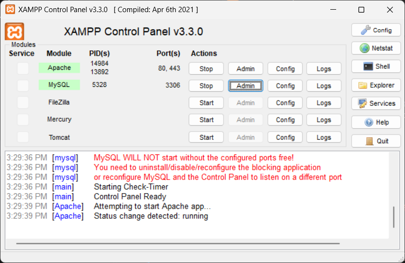
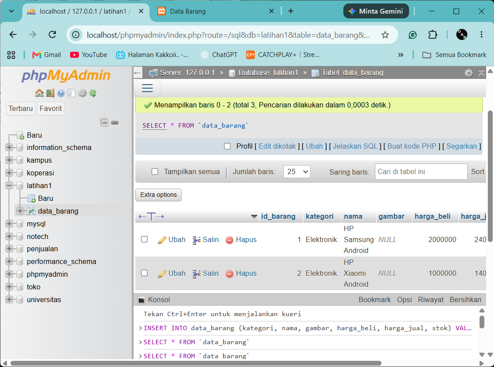
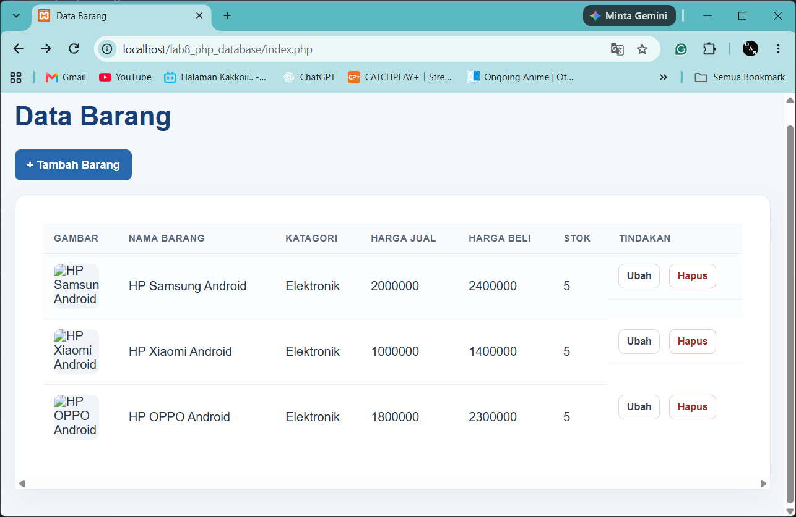
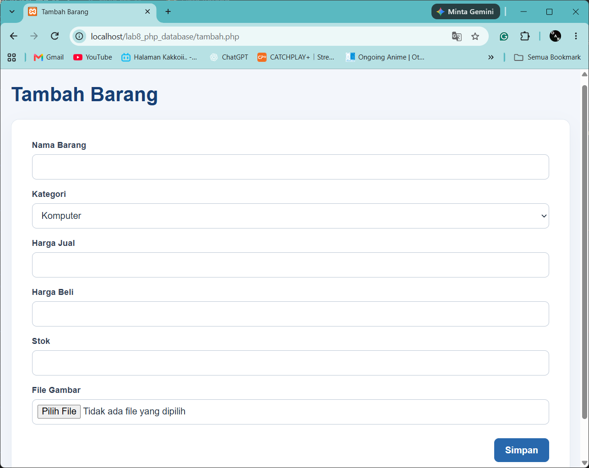
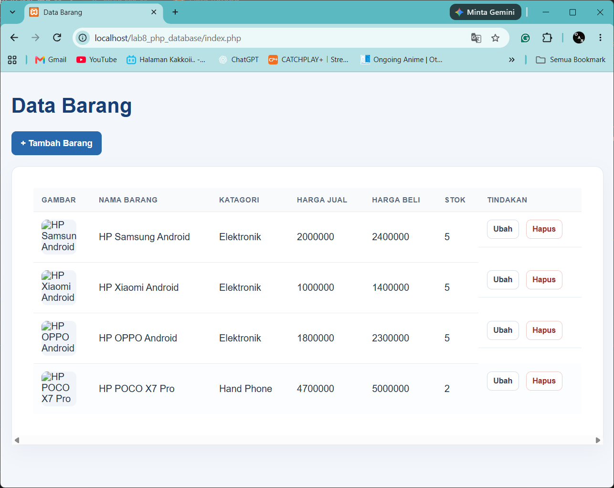
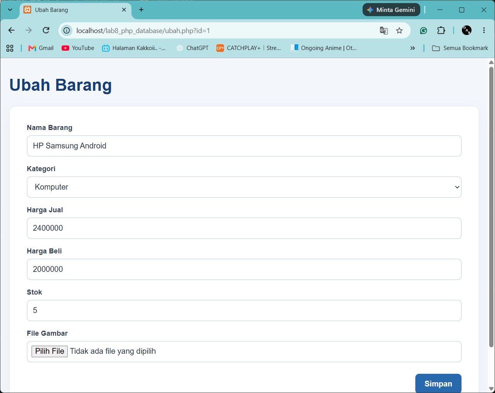
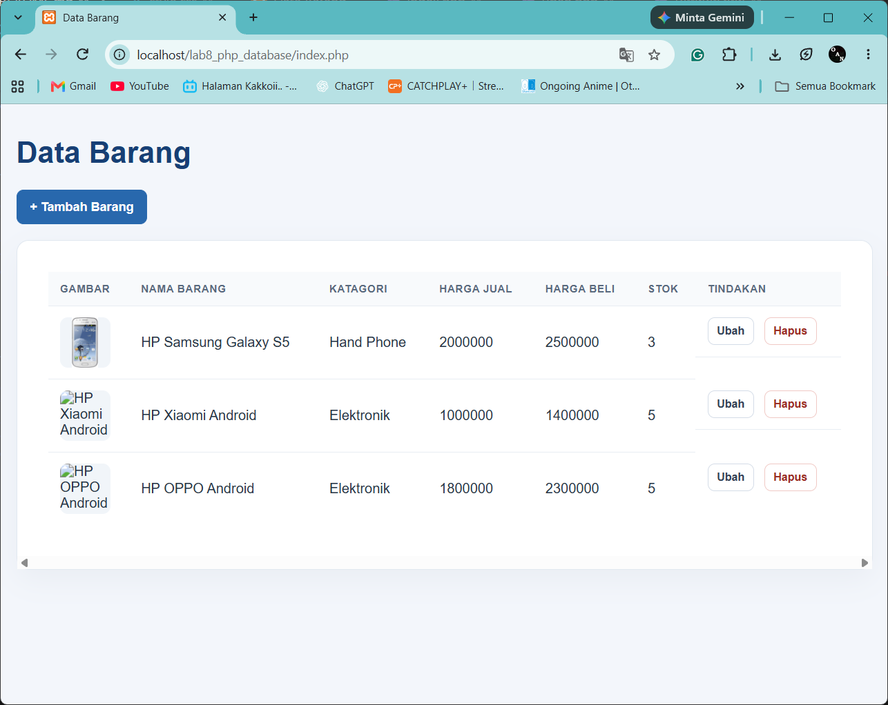

# Langkah Praktikum 8 - PHP dan Database MySQL

**Nama:** Oan Najmi Zertho  
**NIM/Kelas:** 321510027 / I.25.3A  
**Prodi:** Teknik Informatika  
**Mata Kuliah:** Pemrograman Web  
**Dosen:** Agung Nugroho S.Kom, M.Kom

## Tujuan Praktikum

Praktikum ini membahas pembuatan aplikasi CRUD data barang menggunakan PHP dan MySQL. Database menyimpan kategori, nama, gambar, harga beli, harga jual, dan stok. Halaman `index.php` menampilkan data; `tambah.php`, `ubah.php`, dan `hapus.php` menjalankan operasi Create, Update, dan Delete.

## Langkah Kerja

### 1. Menjalankan MySQL Server

Buka XAMPP Control Panel, lalu jalankan Apache dan MySQL. Apache melayani file PHP, sedangkan MySQL menyimpan data aplikasi.



### 2. Membuka phpMyAdmin

Setelah Apache dan MySQL aktif, buka `http://localhost/phpmyadmin/`. Pilih tab **SQL** untuk membuat database, tabel, dan data awal.

### 3. Membuat Database `latihan1`

Jalankan perintah berikut di tab SQL phpMyAdmin.

```sql
CREATE DATABASE IF NOT EXISTS latihan1;
USE latihan1;
```

- `CREATE DATABASE` membuat database bernama `latihan1`.
- `IF NOT EXISTS` mencegah pesan gagal jika database tersebut sudah tersedia.
- `USE latihan1` memilih database untuk pembuatan tabel dan penyimpanan data.

### 4. Membuat Tabel `data_barang`

```sql
CREATE TABLE IF NOT EXISTS data_barang (
    id_barang INT(10) NOT NULL AUTO_INCREMENT PRIMARY KEY,
    kategori VARCHAR(30),
    nama VARCHAR(30),
    gambar VARCHAR(100),
    harga_beli DECIMAL(10, 0),
    harga_jual DECIMAL(10, 0),
    stok INT(4)
);
```

- `id_barang` adalah primary key dan bertambah otomatis saat baris baru ditambahkan.
- `kategori`, `nama`, dan `gambar` menyimpan teks dengan batas panjang sesuai definisi kolom.
- `harga_beli` dan `harga_jual` menggunakan `DECIMAL(10, 0)` untuk nilai Rupiah tanpa angka pecahan.
- `stok` menyimpan jumlah barang.

### 5. Menambahkan Data Contoh

```sql
INSERT INTO data_barang (kategori, nama, gambar, harga_beli, harga_jual, stok)
VALUES
('Elektronik', 'HP Samsung Android', NULL, 2000000, 2400000, 5),
('Elektronik', 'HP Xiaomi Android', NULL, 1000000, 1400000, 5),
('Elektronik', 'HP OPPO Android', NULL, 1800000, 2300000, 5);
```

File `database.sql` berisi versi yang aman dijalankan berulang kali: setiap barang contoh hanya ditambahkan jika namanya belum tercatat.



### 6. Menyiapkan Folder Proyek

Buat folder `lab8_php_database` di dalam `C:\xampp\htdocs`. Susunan file proyek:

```text
lab8_php_database/
├── koneksi.php   # Koneksi MySQL dan fungsi bantuan
├── index.php     # Daftar data barang dan tombol aksi
├── tambah.php    # Form dan proses Create
├── ubah.php      # Form dan proses Update
├── hapus.php     # Menghapus data berdasarkan ID
├── style.css     # Tampilan semua halaman
├── gambar/       # File gambar barang yang diunggah
└── screenshots/  # Bukti langkah praktikum
```

Salin file proyek ke folder tersebut, lalu akses `http://localhost/lab8_php_database/` melalui browser.

### 7. Membuat Koneksi Database

Di awal file PHP, `koneksi.php` membuka koneksi ke MySQL dan memilih database `latihan1`.

```php
$host = 'localhost';
$user = 'root';
$pass = '';
$db = 'latihan1';

$conn = mysqli_connect($host, $user, $pass, $db);
if (!$conn) {
    exit('Koneksi database gagal.');
}
mysqli_set_charset($conn, 'utf8mb4');
```

- `$host`, `$user`, `$pass`, dan `$db` adalah pengaturan koneksi lokal XAMPP.
- `mysqli_connect()` menyambungkan PHP ke MySQL.
- `mysqli_set_charset()` mengatur encoding koneksi ke UTF-8.
- Fungsi `e()` di file yang sama menggunakan `htmlspecialchars()` sebelum teks ditampilkan dalam HTML.

### 8. Menampilkan Data Barang (Read)

`index.php` menjalankan `SELECT * FROM data_barang`, kemudian membuat satu baris tabel untuk setiap hasil query.

```php
include("koneksi.php");
$sql = 'SELECT * FROM data_barang';
$result = mysqli_query($conn, $sql);
```

Perulangan `mysqli_fetch_array($result)` membaca data satu per satu untuk mengisi sel tabel. Kolom Aksi yang sudah ada menampilkan ID barang. Di sampingnya, tombol **Ubah** mengarah ke `ubah.php?id=...`, sedangkan **Hapus** mengarah ke `hapus.php?id=...`. Tombol **Tambah Barang** di atas tabel membuka `tambah.php` tanpa ID karena data baru belum memiliki ID.



### 9. Menambah Data (Create)

Form di `tambah.php` mengirim nama, kategori, harga, stok, dan berkas gambar menggunakan POST. Setelah tombol **Simpan** ditekan, kode mengambil nilai form, menyusun perintah `INSERT INTO data_barang`, menjalankannya dengan `mysqli_query()`, lalu mengarahkan browser kembali ke `index.php`.

```php
$sql = 'INSERT INTO data_barang (nama, kategori, harga_jual, harga_beli, stok, gambar) ';
$sql .= "VALUE ('{$nama}', '{$kategori}', '{$harga_jual}', '{$harga_beli}', '{$stok}', '{$gambar}')";
$result = mysqli_query($conn, $sql);
header('location: index.php');
```

Form gambar menggunakan `enctype="multipart/form-data"`. Jika berkas dipilih, PHP memindahkannya ke folder `gambar/` dan menyimpan alamat relatifnya ke kolom `gambar`.





### 10. Mengubah Data (Update)

Tombol **Ubah** mengirim ID melalui parameter URL. `ubah.php` mengambil data dengan ID tersebut, mengisi form, kemudian menjalankan query `UPDATE` saat form dikirim. ID juga dikirim saat form disimpan melalui input tersembunyi.

```php
$id = $_GET['id'] ?? null;
$sql = "SELECT * FROM data_barang WHERE id_barang = '{$id}'";
$result = mysqli_query($conn, $sql);
```

Jika gambar baru dipilih, file dipindahkan ke folder `gambar/` dan kolom gambar diperbarui. Jika tidak, query mempertahankan gambar sebelumnya.




### 11. Menghapus Data (Delete)

Tombol **Hapus** membuka `hapus.php?id=...`. File tersebut membaca ID dari URL, menjalankan perintah `DELETE` untuk baris dengan ID itu, lalu mengarahkan browser kembali ke `index.php`.

```php
$id = $_GET['id'];
$sql = "DELETE FROM data_barang WHERE id_barang = '{$id}'";
$result = mysqli_query($conn, $sql);
header('location: index.php');
```

Pada implementasi saat ini, penghapusan berjalan langsung ketika tautan Hapus dibuka; belum ada halaman konfirmasi.


